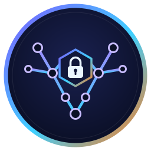

<p align="center">
  
</p>

# Volria

> Projet **éducatif et expérimental** pour étudier la création d’une blockchain compatible avec l’EVM.
> Aucune valeur réelle, aucun réseau public, aucune promesse de fonctionnalité.


## Sommaire

- [Objectif](#objectif)
- [État actuel](#état-actuel)
- [Structure du dépôt](#structure-du-dépôt)
- [Démarrage rapide](#démarrage-rapide)
- [Le jeton de test VolriaToken (VOLRIA)](#le-jeton-de-test-volriatoken-volria)
- [Idées à étudier](#idées-à-étudier)
- [Documentation](#documentation)
- [Sécurité et avertissement](#sécurité-et-avertissement)

## Objectif

Commencer par un prototype **local** ou un **réseau privé de test**, sans argent réel, puis étudier pas à pas les composants d’une blockchain compatible EVM (nœud, consensus, exécution, stockage, RPC).

## État actuel

| Élément | État |
| --- | --- |
| Spécification v0.1 | ✅ Rédigée |
| Contrat de test `VolriaToken` (VOLRIA) | ✅ Écrit |
| Tests automatisés du contrat | ✅ Écrits |
| Script de déploiement (local / Sepolia) | ✅ Écrit |
| Premier transfert sur Sepolia (version de test, symbole VLR) | ✅ Réussi |
| Contrat de test vérifié sur Etherscan Sepolia | ✅ [`0x4e0D...345e`](https://sepolia.etherscan.io/token/0x4e0D0dC6F13CF29eee47b4a528F0C3987793345e) |
| Nœuds de test multiples | ⏳ À faire |
| Études PoW / DAG | ⏳ À faire |

## Structure du dépôt

```text
volria/
├── contracts/
│   └── VolriaToken.sol      # Jeton de test ERC-20 (offre max 1 milliard, mint, burn)
├── bot/
│   └── volria-bot.js        # Bot Telegram (solde VOLRIA + FAQ, FR/EN)
├── scripts/
│   └── deploy.js            # Déploiement local ou Sepolia
├── test/
│   └── VolriaToken.test.js  # Tests automatisés
├── assets/                  # Logo Volria (SVG et PNG)
├── docs/
│   ├── specification.md     # Spécification du prototype v0.1
│   ├── architecture.md      # Composants à étudier
│   └── roadmap.md           # Feuille de route
├── hardhat.config.js
├── package.json
└── .env.example             # Modèle de configuration (à copier en .env)
```

## Démarrage rapide

### Prérequis

- [Node.js](https://nodejs.org/) 18 ou plus récent
- Git

### Installation

```bash
git clone https://github.com/Maxchomakh/volria.git
cd volria
npm install
```

### Compiler et tester

```bash
npm run compile   # compile le contrat
npm test          # lance tous les tests automatisés
```

### Déployer sur un réseau local

Dans un premier terminal, lancez un nœud local (comptes de test fournis automatiquement) :

```bash
npm run node
```

Dans un second terminal :

```bash
npm run deploy:local
```

### Déployer sur Sepolia (optionnel)

1. Copiez `.env.example` en `.env`.
2. Remplissez `SEPOLIA_RPC_URL` et `PRIVATE_KEY` (**portefeuille de test uniquement**).
3. Lancez :

```bash
npm run deploy:sepolia
```

### Déployer sur Ethereum mainnet (argent réel)

> ⚠️ Un contrat déployé sur Ethereum est permanent et les frais sont payés en vrai ETH.
> Utilisez un wallet dédié à Volria, avec seulement l'ETH nécessaire.

1. Remplissez `MAINNET_RPC_URL` et `MAINNET_PRIVATE_KEY` dans `.env`.
2. Estimez le coût **sans rien déployer** :

```bash
npm run estimate:mainnet
```

1. Si le solde suffit et que tout est correct, déployez :

```bash
npm run deploy:mainnet
```

### Vérifier le contrat sur Etherscan

1. Ajoutez `ETHERSCAN_API_KEY` dans `.env`.
2. Après le déploiement, le script affiche la commande exacte à lancer, par exemple :

```bash
npm run verify:sepolia -- <ADRESSE_DU_CONTRAT> <ADRESSE_DU_PROPRIETAIRE> <OFFRE_INITIALE_EN_UNITES>
```

## Bot Telegram

Le dossier `bot/` contient le bot Telegram officiel (français et anglais) :

- envoie une adresse Ethereum (`0x...`) : le bot répond avec son solde VOLRIA ;
- `/faq` : questions fréquentes (adresse officielle, offre, sécurité, arnaques, liens) ;
- `/language` : choix de la langue.

Le bot lit seulement la blockchain : il n'utilise aucune clé privée.

1. Créez le bot avec [@BotFather](https://t.me/BotFather) et copiez son jeton.
2. Ajoutez `TELEGRAM_BOT_TOKEN` (et `MAINNET_RPC_URL`) dans `.env`.
3. Lancez :

```bash
npm run bot
```

## Le jeton de test VolriaToken (VOLRIA)

| Propriété | Valeur |
| --- | --- |
| Nom / symbole | Volria / VOLRIA |
| Décimales | 18 |
| Offre maximale (paramètre de test) | 1 000 000 000 VOLRIA |
| Création (mint) | Réservée au propriétaire, bloquée au-delà de l’offre max |
| Destruction (burn) | Chaque détenteur peut détruire ses propres jetons |
| Base | [OpenZeppelin Contracts](https://docs.openzeppelin.com/contracts/5.x/) v5 |

Les tests vérifient : nom et symbole, offre initiale, transferts, refus sans solde, mint réservé au propriétaire, respect de l’offre maximale et burn.

## Idées à étudier

- Compatibilité EVM et exécution de contrats.
- Preuve de travail (PoW) et structure DAG, testées séparément au départ.
- Offre maximale envisagée de 1 milliard (1 000 000 000 VOLRIA).
- Éventuelle destruction des frais de transaction.
- Confidentialité des transactions, comme piste de recherche.
- Staking et KYC : à étudier plus tard.

Ces éléments sont des **pistes de recherche**, pas des fonctions développées.

## Documentation

- [Spécification v0.1](docs/specification.md)
- [Architecture](docs/architecture.md)
- [Feuille de route](docs/roadmap.md)
- [Logo et Etherscan](docs/logo-etherscan.md)

## Sécurité et avertissement

- Volria est un projet éducatif et expérimental, **non audité**.
- N’utilisez **jamais** d’argent réel, de clés privées réelles ni de données personnelles pour les essais.
- Le fichier `.env` contient des secrets : il est ignoré par Git et ne doit jamais être publié.
- Toute mise en ligne publique nécessiterait des tests approfondis, une revue de sécurité et une analyse juridique.

## Licence

MIT
